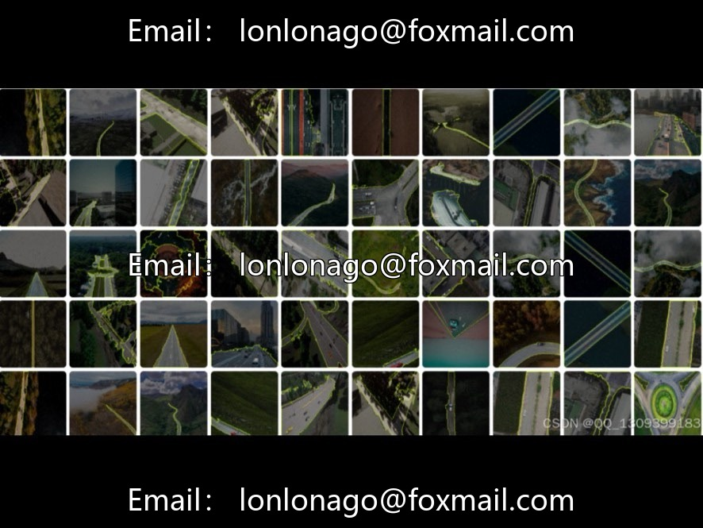
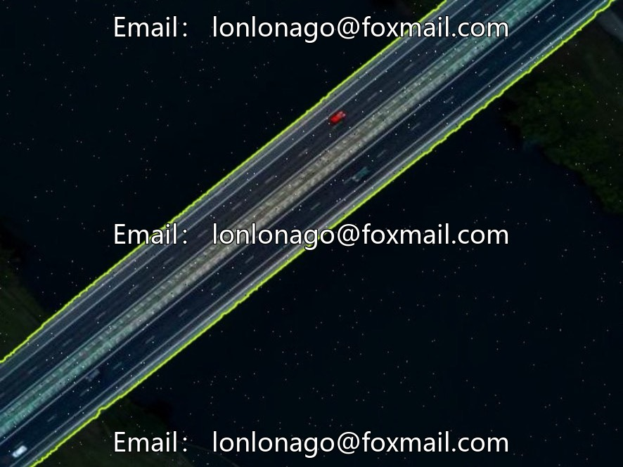
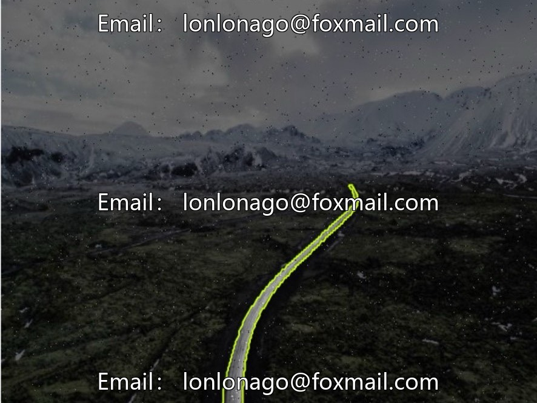
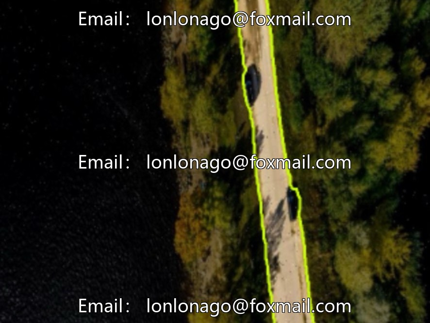

# Drone inspection roadside division dataset, 10005th issue, aerial photography of road examples.

## Body

Drone inspection roadside division dataset, issue 10005, aerial road segmentation example, 4972 images, 640×640 size, 0.41MP, updated in June 2024

The dataset consists of a single set, without division into training/validation/test sets. It employs polygon annotations with complete coordinate information. Supports COCO original JSON+post-labeling conversion. The accompanying editor allows for deletion, saving, reversing, and redoing operations. Comments can approve predictions, convert to bounding boxes, offering comprehensive functionality.

Suitable for drone inspection, road testing, intelligent transportation model training and research, necessary discussion is welcome.

Virtual materials, once sold, are non-refundable.
Interested friends, click "I want" to proceed.

## Images

## Payment

Here is a pay link on Stripe ( https://buy.stripe.com/3cs8yP7sY87d0vu9AB ). Please contact me lonlonago@foxmail.com after funding $89, and I will send you a complete data files , thank you!

